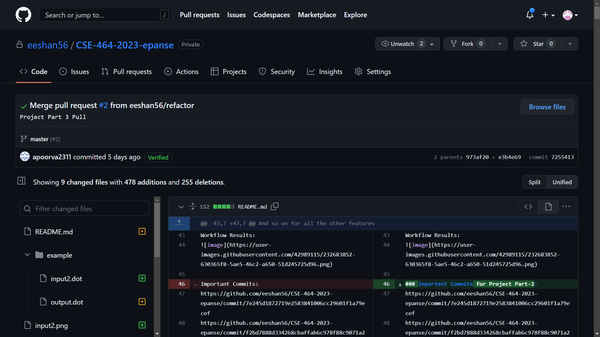
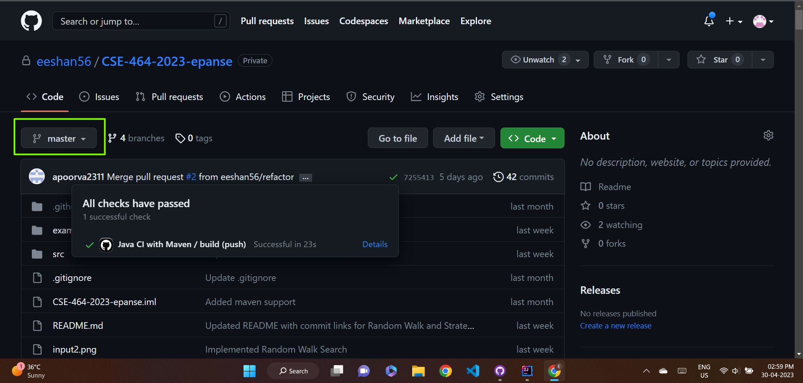

# New README

### Instructions to Run the Code:

We can run Main.java in IntelliJ. The menu options are as follows:

    Welcome!!!
    Select 1 of the following options:
    1. Parse Graph from DOT file
    2. Print nodes and edges of the graph
    3. Add node(s) to the graph
    4. Add edge(s) to the graph
    5. Remove edge(s) from the graph
    6. Remove node(s) from the graph
    7. Output graph to DOT file
    8. Output graph to Image
    9. BFS/DFS/RWS
    10. Exit

One can refer to the original README for instructions to run Add/Delete nodes/edges. Instructions to
get BFS/DFS/RWS results are also stated later.

### Project Part 3 changes:

#### a) Refactoring:

1) [Refactor 1: Changed if-else to ternary operations (commit link)](https://github.com/eeshan56/CSE-464-2023-epanse/commit/12d7674ddfd5ff4a3a76a106c6405e2d8a1370e9)

In this code refactoring, redundant if-else conditions were made inline:

    isDuplicate = false
    .
    .
    .
    if(node.name().equals(nodeName))
        isDuplicate = true

This was converted to:

    isDuplicate = (!isDuplicate) ? node.name().equals(nodeName) : true;

2) [Refactor 2: Added String Constants in place of String values (commit link)](https://github.com/eeshan56/CSE-464-2023-epanse/commit/83148dc1c78e987dc66a71b67a2962e14bf91195)

In this code refactoring, String literal values like "bfs", "png" were replaced by storing
them in constant variables like:

    public static final String DEFAULT_DOT_FILEPATH = "src/main/java/org/example/color.dot";
    public static final String REGEX_UNDIRECTED_CONNECTOR = "--";
    public static final String REGEX_DIRECTED_CONNECTOR = "-->";
    public static final String JPG_STR = "jpg";
    public static final String PNG_STR = "png";
    public static final String BFS_STR = "bfs";

These constants were then used throughout the Main and GraphManagerTest classes to ensure
re-usability.

3) [Refactor 3: Removed Dead Code and Unnecessary Repetition (commit link)](https://github.com/eeshan56/CSE-464-2023-epanse/commit/a31747dce4a0379aebfbab32e353dfbed7b019ee)

In this code refactoring, commented code that was dysfunctional and of no use was removed.
Also, unnecessary initialization of the variable "defaultPngFilename" was corrected to initializing
it just once at the start of the execution and using the same value throughout all features.

4) [Refactor 4: Rename Variables (commit link)](https://github.com/eeshan56/CSE-464-2023-epanse/commit/4c2e08a0a952dea15b21d279c5cf5186d0f02e63)

In this code refactoring, variables in the for loop iterations like:

    for(MutableNode node : nodeSet) {}

were updated to:

    for(MutableNode currNode : nodeSet) {}

Or:

    for(MutableNode currPathNode : currPath) {}

5) [Refactor 5: Extracted method to check if graph is uninitialized (commit link)](https://github.com/eeshan56/CSE-464-2023-epanse/commit/810728f9d9aae98b59978f8b36c1325399886454)

In this code refactoring, similar operations that were repeatedly being executed
were added to a function and that function was called each time those set of operations
were needed. It was the case of checking if the graph had been initialized or not:

    if(this.graph == null || this.dotFilePath == null) {
        this.initGraph();
    }

These steps were added to a function:

    public void checkIfGraphIsNull() {
        if(this.graph == null || this.dotFilePath == null) {
            this.initGraph();
        }
    }

#### b) Design Pattern for BFS/DFS: [commit link](https://github.com/eeshan56/CSE-464-2023-epanse/commit/10fa16e05fe2694d1ddbdf226c9c90d93ddd2784)

In this feature, I applied the Template pattern to extract common behaviors of BFS and DFS and create separate classes to implement the differences between the two search algorithms.

The GraphSearchTemplate class is the abstract base class that defines the common algorithmic steps for graph search. This class contains a public method graphSearch that defines the template algorithm for graph search. This method takes in a source node, a destination node, and a search algorithm as input parameters.

The BreadthFirstSearch and DepthFirstSearch classes are concrete subclasses of GraphSearchTemplate that implement the specific differences between BFS and DFS. These classes override the GraphSearchTemplate method and provide their own implementation of the search algorithm.

By using the Template pattern, I was able to extract the common algorithmic steps of graph search and implement the specific differences between BFS and DFS in separate classes. This approach makes the code more modular, easier to read and maintain, and allows us to easily add new search algorithms in the future.

To use these classes, simply create an instance of the BreadthFirstSearch or DepthFirstSearch class, and call the GraphSearch method with the appropriate parameters.

Example Usage
Here's an example of how to use BreadthFirstSearch and DepthFirstSearch classes to perform a graph search:

    MutableNode src = new MutableNode("A");
    MutableNode dst = new MutableNode("D");

    GraphSearchTemplate bfs = new BreadthFirstSearch();
    Path bfsResult = bfs.GraphSearch(src, dst);
    
    GraphSearchTemplate dfs = new DepthFirstSearch();
    Path dfsResult = dfs.GraphSearch(src, dst);

#### c) Strategy Pattern for BFS/DFS: [commit link](https://github.com/eeshan56/CSE-464-2023-epanse/commit/4c60fe21088ed98eae55b89a84c09c27a9b38d92)

To implement the ability to choose between Breadth First Search (BFS) and Depth First Search (DFS)
in the GraphSearch method, I applied the strategy pattern. I created an interface
Algorithm to define the common behavior of the search algorithms, and the abstract class
GraphSearchTemplate that implements this interface to define the specific behavior for BFS and DFS, respectively.

The GraphSearchStrategy method of GraphManager class was then modified to take an Algorithm
parameter that determines which algorithm to use, and creates an instance of either
BreadthFirstSearchStrategy or DepthFirstSearchStrategy accordingly. This instance is then passed to
GraphSearchStrategy's search method, which calls the useQueue method to determine whether
to use a queue or stack, and performs the search accordingly. Here, we have taken different classes
GraphSearchTemplate and GraphSearchStrategy to give the user freedom to choose their desired
design pattern for the execution of the 3 searches (BFS, DFS, Random Walk Search).

#### d) Random Walk Search: [commit link](https://github.com/eeshan56/CSE-464-2023-epanse/commit/e709be9834182f26e6a890f6366b22868850d89e)

This was a new algorithm that was implemented using the same template and strategy patterns that
were used in the previous features. A new class `RandomWalkSearch` was added and extended
the GraphSearchTemplate. However, since its implementation is different from that of BFS
and DFS, it overrides the `Path GraphSearch(MutableNode src, MutableNode dst)` abstract method
and randomly visits unvisited neighbours of the current node where it has traversed and returns
a path from the source node to the destination node. It also re-initializes its search if there are
no unvisited nodes that it can traverse during runtime.

Sample results:

Input Graph:

Results (These contain instructions to run bfs/dfs/rws):

    Enter the search algorithm(BFS/DFS/Random Walk Search-RWS): rws
    Enter the desired Design Pattern (Template/Strategy): strategy
    Enter the source node name: a
    Enter the destination node name: h
    Random Walk Search via Strategy Pattern
    Path traversed: a --> e
    Path traversed: a --> e --> f
    Path traversed: a --> e --> f --> h
    path = a --> e --> f --> h

    Enter the search algorithm(BFS/DFS/Random Walk Search-RWS): rws
    Enter the desired Design Pattern (Template/Strategy): template
    Enter the source node name: a
    Enter the destination node name: h
    Random Walk Search via Template Pattern
    Path traversed: a --> b
    Path traversed: a --> b --> c
    Path traversed: a --> b --> c --> d
    No more unvisited nodes to traverse were found.
    Starting from source again...
    Path traversed: a
    Path traversed: a --> e
    Path traversed: a --> e --> g
    Path traversed: a --> e --> g --> h
    path = a --> e --> g --> h

Here, we can see that there is an additional input taken from the user:
    
    Enter the desired Design Pattern (Template/Strategy):

This is used to implement Template Pattern and Strategy Pattern separately according to the user's choice.

#### d) [Merge Pull Request link](https://github.com/eeshan56/CSE-464-2023-epanse/commit/72554139b4be861f41d697e855211cad39d97716):

The pull request was successfully merged into master:

